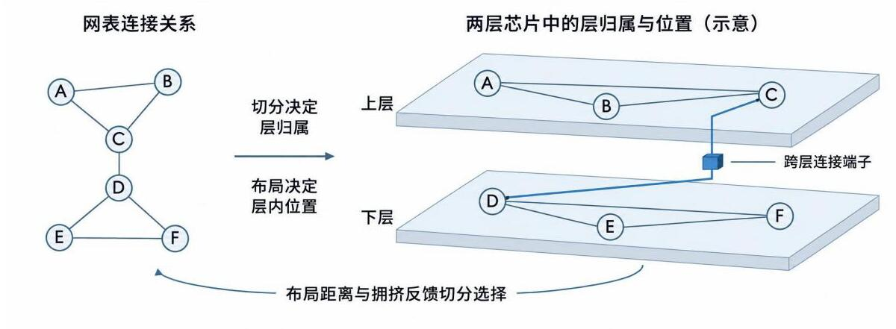

## 面向 3D 芯片物理设计的多阶段算法协同演化

“韬”智能杯 EDA 创新大赛--基于自演化智能体的 3D 芯片物理设计算法优化

## 一、赛题背景

集成电路长期依靠晶体管尺寸缩小来提高集成密度，并在单位晶体管成本、 性能和能效方面持续受益。随着制造工艺不断接近物理与工程极限，进一步缩小器件面临更高的制造成本和漏电流控制难度，供电电压难以继续下降也使芯片功率密度不断上升。与此同时，芯片内部的数据传输距离和互连延迟逐渐成为性能提升的重要制约。如何在有限工艺条件下继续提高芯片集成能力、延续摩尔定律所代表的发展趋势，已成为先进芯片设计的重要问题。

三维芯片将电路从二维平面扩展到垂直堆叠的多个有源层，通过混合键合等高密度层间互连技术把多个有源层连接起来，使信号可在垂直方向传输，从而在有限投影面积内集成更多逻辑与存储资源，并缩短部分长距离连接。逻辑折叠(Logic Folding)在此基础上进一步细化划分粒度:它不局限于沿既有模块边界切分，而是将同一逻辑块内部原本铺展在一个平面上的单元分布到不同层，使关键路径上较长的水平连接转化为较短的垂直连接。这为突破单纯依赖工艺微缩的限制提供了新的途径，但收益仍取决于电路如何划分到多个晶片层、单元如何放置，以及后续设计环节能否保留这些收益[1-2]。

三维结构增加了设计自由度，也使算法之间的相互影响更复杂。一个阶段的局部改进未必能转化为最终时序改善，因此需要在完整的物理设计流程中检验算法效果。Open3DBench 为三维芯片后端实现与评价提供了开放基础[3]。本赛题在此基础上引入基于大模型的算法演化:由智能体读取代码和评估反馈，提出、验证并保留有效修改，研究在有限试验预算下如何持续改进三维芯片物理设计算法。

## 二、赛题应用场景

先进移动芯片、通用处理器、人工智能加速器及高带宽计算系统，都面临更高集成密度、更低通信开销和更好能效的需求。三维集成既可用于逻辑与存储堆叠， 也可用于逻辑与逻辑堆叠。面向后者的逻辑折叠技术可以将联系紧密但在平面上相距较远的单元分置于上下相邻的层，从而缩短关键路径，并为同等性能下的降压和节能创造条件。

---

1 EDA 为 Electronic Design Automation(电子设计自动化)。

---

华为提出的“韬(7)定律”以缩短信号传播的特征时间为核心，将优化视角从器件几何尺寸扩展到电路、芯片和系统[1]。其公开论文以麒麟片上系统(System on Chip, SoC)为代表，介绍了逻辑折叠在处理器和计算模块中的应用:利用混合键合连接上下层逻辑，缩短关键互连，并结合工作频率、电压和热分布进行设计[2]。 麒麟等移动 SoC 对面积、性能和功耗的严格要求，体现了三维物理设计算法的实际应用价值。本赛题围绕这类逻辑折叠设计需求，使用开源基准芯片研究双层逻辑芯片的切分、布局与后续时序优化。

## 三、赛题任务

参赛者需实现智能体运行框架(Agent Harness，下称 harness)，使其能够调用统一基座模型，读取初始算法、生成和修改代码、提交候选评估，并根据日志与指标选择后续方案。最终交付选定的 harness 版本、由其生成并选定的算法代码， 以及对应的切分和布局结果。赛题包含以下两项任务。

## (一)时序驱动的切分和布局协同优化

网表描述逻辑单元、宏块及其连接关系。切分算法决定各实例属于上层还是下层，布局算法则确定它们在所属层内的坐标。两者共同影响互连距离、局部密度和关键路径:切分改变每层的空间需求，布局结果又能为切分提供实际距离和拥塞信息。参赛者需联合改进这两个环节，使层归属与层内位置相互配合。

1. 网表切分。传统方法通常将网表表示为超图，以单元为节点、以连接多个引脚的网为超边，在面积平衡约束下减少跨层网络。多层次方法先合并联系紧密的节点, 在较小规模的图上切分, 再逐层还原并细化结果。然而, 单纯减少切割网数量仍不足以判断性能变化，还需考虑单元面积、连接长度和时序关键性等信息。

赛题基线采用借鉴文献[4]思路的图神经网络(Graph Neural Network, GNN) 切分实现。它利用连接结构和单元特征学习节点表示，再将节点分配到两层，并修复不满足面积或宏块平衡约束的分组。参赛者可以在获准范围内改进特征构造、学习目标、分组与面积平衡修复策略，使切分结果更有利于后续布局及时序优化。

2. 双层布局。解析布局把单元坐标作为连续变量，将平滑线长与密度惩罚组合为优化目标，通过梯度迭代更新位置；随后进行合法化，消除单元重叠并满足放置规则。DREAMPlace 利用深度学习计算框架加速这类数值优化[5]。赛题采用双层协同解析式布局，同时考虑各层密度及跨层连接，可以改进线长与密度建模、时序权重、位置更新和合法化等获准实现。相关三维解析布局研究可参见文献[6]。

3. 评估。评测按 “切分 \( \rightarrow \) 布局与合法化 \( \rightarrow \) 供电网络构建 \( \rightarrow \) 跨层端子分配 \( \rightarrow \) 时序优化 \( \rightarrow \) 静态时序分析”运行，在布局和时序优化全部结束之后收集时序指标。该任务仅开放切分和布局环节的获准源代码和参数，后续评估流程保持固定。



图 1 切分确定层归属，布局确定层内位置，两者共同影响跨层连接

## (二)时序驱动的全流程算法演化

本任务将优化范围扩展到网表切分、布局、跨层端子分配、时序优化、时钟树综合和全局布线六个环节，以全局布线后的时序为共同优化目标，并计入布线溢出惩罚。参赛者需要联合设计各环节的算法，使前序决策与后续优化相互配合，并根据最终评测结果整体调整。

全流程搜索同时涉及单元层归属、端子匹配、时钟树结构等离散决策，以及布局坐标、目标权重等连续变量。前序改动会改变后续算法的输入，时序关键路径也可能随之转移。各环节之间也存在直接的约束传递。比如，时序优化插入的缓冲器虽能改善驱动能力，也会占用布局空间并增加布线需求。因此，协同优化需要权衡这些相互影响，检验局部改进能否转化为全流程收益[3]，并实现在不同算例上保持可泛化的收益。

在赛题允许的源码和参数范围内，可探索的主要决策及其协同关系如下。

1. 切分与布局。可改进切分目标中的时序权重、单元层归属及平衡修复策略， 以及布局中的线长与密度权衡、关键网络权重和合法化策略。除控制连接长度外， 还需考虑跨层端子需求、各层局部拥挤程度及后续缓冲器的放置空间，使布局结果适合端子分配、时钟树构建和布线。

2. 跨层端子分配。混合键合端子(Hybrid Bonding Terminal，HBT)连接上下两层的跨层网络。HBT 之间的中心间距(pitch)较大，可用位置受到限制，需满足最小间距和不重叠等合法化约束。端子位置会改变跨层网络在上下两层中的连接长度，进而影响互连延迟和关键路径时序。

3. 时序优化(Timing Optimization)。可改进关键路径的修复顺序、缓冲器插入位置、单元尺寸选择及引脚交换策略。优化需结合端子分配后的实际连接关系， 权衡延迟收益与新增单元的空间、负载和布线代价，避免局部修复加剧后续拥塞。

4. 时钟树综合(Clock Tree Synthesis, CTS)。可改进时钟接收端的分组方式、 树的分支结构、缓冲器选择与布置策略。切分和布局决定时钟接收端的空间分布， 时钟树又会改变各端点的到达时间及数据路径的时序裕量，因此需要同时考虑时钟延迟、偏斜和信号转换时间，以及对后续布线资源的占用。

5. 全局布线(Global Routing, GRT)。可改进关键网络的布线优先级、路径与金属层选择、拥塞代价及重布线策略。在固定布线资源下，需要权衡关键路径延迟与网络间的资源竞争。布线产生的绕行及寄生参数变化，可用于判断前序切分、 布局、端子和缓冲器决策是否合适，并指导下一轮候选修改。

评测按规定顺序执行上述六个环节，并保留固定的供电网络构建步骤。静态时序分析(Static Timing Analysis, STA)采用传播时钟和全局布线估算的寄生参数， 在连通的双层时序视图中采集结果。本任务的计分终点为全局布线完成后，不要求详细布线签核。阶段日志用于定位问题，候选取舍以统一的全流程评测结果为依据。 相关接口及参数详见 OpenROAD 官方文档[7]。

## 四、数据集及数据说明

## (一)数据来源与划分

赛题选用五个公开算例，算例名称由电路名称与工艺平台标识组成。工艺设计套件(Process Design Kit，PDK)提供所用工艺的器件、布线层和设计规则。ng45 对应 Nangate \( 45\mathrm{\;nm} \) 开放库平台，asap7 对应亚利桑那州立大学 \( 7\mathrm{\;nm} \) 预测工艺平台(ASAP7)。

训练集包含 bp_fe-ng45、bp-ng45、ariane133-ng45 三个算例，用于 harness 的候选生成、反馈分析和算法选择。它们分别覆盖处理器前端、处理器设计和另一类处理器实现，可用于观察同一算法在不同网表结构和规模上的表现。

验证集包含 swerv_wrapper-ng45、bp_fe-asap7 两个算例，用于算法的泛化检验及初赛统一评分。其中 bp_fe-asap7 与训练集中的 bp_fe-ng45 具有相同电路来源、 不同工艺条件，主要检验跨工艺适应能力。正式演化运行中，验证集结果不用于继续修改或选择候选。

决赛另设两个未公开算例，作为决赛算法成绩的统一测试集，具体设计名称和输入内容在正式评测前保密。决赛各参赛队伍确定最后候选算法后，由组委会在两个隐藏算例上评测。

## (二)随机种子

每个算例均使用 1001、1002、1003 三个随机种子进行算法评估，以削弱算法运行的随机性影响。候选算法与初始算法采用相同输入、工艺、时钟约束和随机设置。先分别计算每个种子的得分，再对三个种子取算术平均，最后对所有算例等权加和。

## (三)输入文件与格式

1. 电路网表 (.v) 。采用 Verilog 文本格式，描述模块端口、标准单元实例及引脚之间的连接。网表说明“哪些单元相连”，通常不描述其物理坐标。以下是简化示例，实际单元类型及引脚名称应与提供的库一致。

```
module example(input a, input b, output y);
  wire n1;
  NAND2_X1 U1 (.A1(a), .A2(b), .ZN(n1));
  INV_X1 U2 (.A(n1), .ZN(y));
endmodule
```

2. 物理设计文件(Design Exchange Format, DEF, def)。描述设计边界、坐标单位、放置行、外部引脚、单元位置及网络等物理信息。输入 DEF 可提供布局规划，输出 DEF 记录算法产生的放置结果。下例为片段:每微米对应 1000 个数据库单位，U1 的位置为(10μm，20μm)，朝向 N 表示标准朝向。

```
VERSION 5.8 ;
DESIGN example ;
UNITS DISTANCE MICRONS 1000 ;
DIEAREA ( 0 0 ) ( 100000 100000 ) ;
COMPONENTS 2 ;
- U1 NAND2_X1 + PLACED ( 10000 20000 ) N ;
- U2 INV_X1 + PLACED ( 12000 20000 ) N ;
END COMPONENTS
#Rows, pins and nets are omitted in this excerpt.
```

3. 库与约束。库交换格式(Library Exchange Format，LEF，lef)描述布线层、 过孔规则，以及单元尺寸、引脚和遮挡区域；Liberty 库(.lib)提供单元时序、功耗与负载模型。Synopsys 设计约束(Synopsys Design Constraints, SDC, .sdc)定义时钟、输入输出延迟等分析条件，例如 “create_clock -name core_clk -period 1.0 [get_ports clk]”定义周期为 \( 1\mathrm{\;ns} \) 的时钟。

## 五、算法设计要求

## (一)演化对象

切分布局协同优化开放切分、布局的算法源代码及获准参数；全流程算法演化进一步开放跨层端子分配、时序优化、时钟树综合和全局布线的获准源码与参数。

所有候选均须保持物理设计合法性。例如，布局须满足放置区域边界、单元无重叠，以及标准单元的放置行、站点对齐和合法朝向等约束；跨层端子须位于合法候选位置、满足最小间距，并保持跨层网络正确连通。

## (二)Harness 设计

Harness 应组织 “提出修改—生成代码—检查代码—提交评估—分析反馈—选择方案”的算法演化循环，并保存可追溯的算法候选历史。参赛者可设计和改进提示词、搜索策略、失败诊断和候选保留等环节。

Harness 可由参赛者人工设计，也可由智能体修改 harness 自身的代码、提示模板和执行逻辑，迭代提升其分析反馈与修改算法的能力，实现算法修改能力的自演化。参赛者自行选定最终提交的最优 harness 版本，赛题不限定该版本的形成方式。算法演化与 harness 自我改进的相关研究可参见文献[8-9]。

本赛题统一使用 DeepSeek-V4.1-Flash 作为基座模型, 通过应用程序编程接口 (Application Programming Interface, API)调用。官方以最终提交的 harness 为评测对象，从统一的初始算法出发，在相同基模和预算下运行，以所得算法的物理设计表现衡量其迭代改进算法的能力。提交时须固定最终 harness 版本、提示模板及运行配置，供组委会统一复跑。

## 六、性能指标要求

(一)时序指标与改善比例

时序指标采用最差负时序裕量 (Worst Negative Slack, WNS) 和总负时序裕量 (Total Negative Slack，TNS)，单位为纳秒。前者描述最严重的建立时间违例，后者汇总所有受约束端点的负建立时间裕量。将负时序裕量值取绝对值，得到非负违例量，该违例量越小，时序越好。

单项改善比例 \( = \) (初始算法违例量一候选算法违例量) \( \div \) 初始算法违例量

以同算例、同种子下的官方初始算法作为比较基准。改善比例为正表示违例减少，为负表示退化。WNS 与 TNS 分别计算改善比例。

## (二)两项任务的得分

切分布局得分 \( = 40\% \times \) WNS 改善比例 +60% \( \times \) TNS 改善比例

切分布局任务在且仅在一次时序优化后的阶段采集结果，采用布局估算的互连寄生参数和理想时钟。时序分析设置由评估器固定。

全流程得分 \( = 40\% \times \) WNS 改善比例 +60% \( \times \) TNS 改善比例一布线溢出惩罚

全流程任务在双层全局布线完成后采集时序，采用传播时钟与全局布线估算的互连寄生参数。布线溢出取两层溢出量之和:总量不超过 300 时惩罚为 0 ，超过 300 时按下式计算，不设置惩罚上限。

布线溢出惩罚 \( = 10\% \times \) (布线溢出总量 -300)÷300

先按每个算例的每个种子计算上述得分，然后平均多个种子的结果。所有算例的结果会再进行等权加和，作为最终评分。所有队伍使用相同的初始算法参考值， 不依赖其他队伍成绩进行归一化。

## 七、功能要求

Harness 应能从统一入口启动，读取指定任务和预算，生成可应用的算法修改， 并按评估接口返回的信息继续运行。候选算法确定后，应能在不人工修改输入或结果的条件下完成两个任务的算法执行。

候选需通过代码范围、各设计阶段完成性、网表连通性和时序图完整性等合法性检查。指标缺失、非法数值、连接不完整、阶段失败或超时均属于无效结果。最终候选的必测算例与种子必须全部有效。

## 八、开发环境

官方评测平台基于 Open3DBench 和 OpenROAD 开发。组委会提供包含 Python、PyTorch、DREAMPlace、OpenROAD、三维芯片设计流程初始代码及调用示例的统一开发容器。正式评测在统一计算资源配置下执行。

## 九、成绩评价

## (一)初赛成绩

初赛成绩 \( = 80\% \times \) 切分布局得分 +20% × 全流程得分

初赛以三个训练集算例和两个验证算例的得分等权加和作为成绩，不设答辩评分。按成绩从高到低确定最多 6 支队伍进入决赛。

## (二)决赛成绩

决赛算法成绩 \( = 20\% \times \) 切分布局得分 +80% 全流程得分

决赛成绩 \( = 50\% \times \) 决赛算法成绩(百分制) +50% * 答辩成绩(百分制)

决赛以训练集、验证集和隐藏算例(共七个算例)的得分等权加和作为算法成绩。以本届决赛最高算法原始成绩为基准，将其归一化为 100 分，其他队伍按比例计算百分制分数。答辩成绩采用百分制，由评审专家根据技术报告、演示及现场问答独立评分后取平均。答辩评分包括以下四项。

1. Harness 设计与方法创新(45 分):说明搜索、反馈利用和候选选择等 harness 环节的设计依据，并区分已有方法与团队贡献。

2. 算法分析与实验论证 (30 分) :分析 harness 的实验结果，可提供关键改动的消融实验及案例分析。尝试解释智能体演化出的算法。

3. 可复现性与材料完整性(10 分):代码、配置、演化日志和结果应相互对应，复现过程完整。

4. 现场陈述与问答(15 分):表达准确清晰，能够解释技术选择、实验结论及方法局限。

## (三)复核与名次确定

组委会统一复跑参赛队提交的最终 harness，每次复跑均从官方初始算法开始。 算法成绩依据正式运行中生成的算法来评测。参赛队提交的算法代码、结果与日志用于复现、提前核验和初步成绩筛选。针对模型 API 调用的随机性，组委会将采用多次复跑取最优结果的策略。

初赛不设置排行榜，成绩经统一评测与复核后公布。初赛同分时优先比较切分布局得分，决赛同分时优先比较决赛算法成绩，再比较全流程得分。仍同分时按实际 API 费用由少到多比较。晋级临界位置仍无法区分时，由组委会复核裁定。

## 十、解题思路

参赛者可先从基线的关键路径、层间连接和拥塞分布中确定主要问题，再围绕少量可解释的算法假设组织演化。例如，将时序关键性引入切分目标。全流程任务还应检查前序收益是否被端子分配、时钟树或布线绕行抵消。

## 十一、赛题约束条件

## (一)评估隔离与代码边界

算法改动与官方评估逻辑相互隔离。候选可以改变允许的设计决策，不得修改评估算法、指标提取与计分程序、参考数据、预算记录，以及违例定义和结果有效性判定。输入网表、工艺条件、时钟约束等输入数据及约束不得篡改。

## (二)外层评估循环与预算

组委会在参赛队提交的 harness 之外，再设置一层官方评估循环。外层循环负责启动和监控参赛 harness，通过统一模型调用代理记录 API 用量与人民币费用， 通过评估接口核验候选算法并登记评估次数。参赛 harness 负责搜索决策，不能修改、绕过或重置外层计量。

单任务的单次运行设置最多 30 次候选评估和 15 元人民币(非高峰期价格)的 API 调用费用上限。任一预算达到上限，外层循环即停止新的模型调用或候选评估。

一次候选评估是指:一个候选算法提交后，评估器在训练集及三个种子上完成整组评估。三个训练算例与三个种子组成的 9 次全流程运行合计记为一次候选评估。

正式运行中的所有大模型调用均须经过官方代理，使用指定的 DeepSeek-V4.1- Flash 版本，不得更换或混用其他基模。

## (三)数据与过程要求

不得通过算例名称、隐藏输入身份或参考答案硬编码结果，不得在正式运行中人工干预算法生成与选择。公开论文和开源代码可作为方法参考，使用位置、版本及许可证须在材料中说明。

## 十二、参考文献

[1] He, T. A time scaling theory for multi-layer electronic systems. Science China Information Sciences, 69: 183401, 2026. DOI: 10.1007/s11432-026-5028-5.

[2] He, T. Huawei's & Chip Was Supposed to Melt?. arXiv:2609.04287, 2026.

[3] Shi, Y., Gao, C., et al. Open3DBench: Open-Source Benchmark for 3D-IC Backend Implementation and PPA Evaluation. arXiv:2503.12946v2, 2026.

[4] Lu, Y.-C., et al. TP-GNN: A Graph Neural Network Framework for Tier Partitioning in Monolithic 3D ICs. Design Automation Conference, 2020.

[5] Lin, Y., et al. DREAMPlace: Deep Learning Toolkit-Enabled GPU Acceleration for Modern VLSI Placement. Design Automation Conference, 2019.

[6] Liao, P., et al. Analytical Die-to-Die 3-D Placement With Bistratal Wirelength Model and GPU Acceleration. IEEE Transactions on Computer-Aided Design of Integrated Circuits and Systems, 43(6), 2024.

[7] OpenROAD Project. OpenROAD Documentation.

[8] Novikov, A., et al. AlphaEvolve: A Coding Agent for Scientific and Algorithmic Discovery. arXiv:2506.13131, 2025.

[9] Zhang, J., et al. Darwin Gödel Machine: Open-Ended Evolution of Self-Improving Agents. arXiv:2505.22954, 2025.

## 十三、提交要求

## (一)需提交的技术材料

初赛与决赛均须提交选定的最终 harness、由其生成并选定的算法代码, 以及两项任务的物理设计结果。相关作品材料整理至同一文件夹, 材料统一打包为 ZIP (.zip)压缩文件，命名为“参赛编号_赛题 1 初赛.zip”或“参赛编号_赛题 1 决赛.zip”。上传至 “作品材料文件夹百度网盘链接” 入口，请参赛选手认真检查链接的有效性，分享链接可设置为永久有效，确保评委能够顺利访问材料。作品材料检查无误后上传至在线网盘(推荐使用百度网盘，分享时选择自动填充提取码)。

1. 说明与清单。README.md 写明运行命令、目录用途和复现步骤。如需修改容器中的代码依赖环境，请提供 requirements.txt 以固定额外依赖版本。

2. Harness 源码。harness/ 包含选定最终版本的完整源码和 run.sh 统一启动入口。无论由人工设计还是由智能体自我迭代产生，均只需提交最终 harness 版本， 无需提交其开发阶段的初始版本和历次修改记录。

3. 算法代码。algorithms/ 下分别设置 partition_placement/ 与 full_flow/，每项包含相对官方基线的 candidate.patch 和其他必要的新增源码文件。candidate.patch 采用标准 Git 文本差异格式，不能仅提交编译后的可执行文件。

4. 切分与布局等物理设计结果。物理设计结果按“子任务/算例/种子”组织，包含切分方案、上下层布局、评测指标和时序报告。全流程任务另附全局布线结果。

5. 运行日志。logs/ 保存最终 harness 运行时的算法演化记录，包括算法改动的父子关系、代码版本、评估结果和失败原因等信息，供组委会初步核验和筛选。

## (二)需提交的文字材料

初赛和决赛都需提交技术报告，报告应覆盖附录所列内容。说明 harness 设计原理和实验结果分析。决赛另提交答辩演示稿。

## 十四、其他说明

赛题设初赛和决赛两个阶段。报名、任务发布、提交截止、答辩和成绩公示时间以赛事通知为准。奖励、名额、证书及奖金安排以大赛章程和赛题通知为准。

参赛成果须注明论文、开源代码及外部工具的贡献。比赛过程中，参赛队伍可反馈赛题相关的问题，组委会进行答疑与勘误。

## 十五、联系方式

赛事信息与报名:www.aicomp.cn/notice/notice-3/5484.html。本赛题交流方式与技术支持渠道以正式赛事通知为准。

## 附录 技术方案大纲

技术报告应围绕方法设计与实验结果展开，可按以下结构组织。

## 一、算法概述

说明所解决的问题和已有的主流方法。

## 二、实现方案

给出 harness 设计的 motivation 和主要思路。给出 harness 具体的工作流程或伪代码，说明提示词组织、工具调用、反馈分析与候选选择等流程。

尝试解释该 harness 演化出的算法代码。

## 三、实验与创新点

列出各算例的完整指标，比较基线和最终算法方案的结果，并分析演化效率。 可提供关键算法部件的消融实验。

## 四、问题与思考

分析未改善的算例，讨论跨算例和跨工艺适应、搜索稳定性及方法局限。

## 五、过程进度与团队分工

简述主要版本、迭代过程和预算消耗，列明成员分工、外部指导及工具辅助的作用。

## 六、复现与参考资源

给出完整复现入口及材料索引，列明论文、代码、软件、模型与数据来源、版本和使用位置。